# Guia d'ús de Bitwarden per a l'Equip Tècnic d'EverPia

**Mòdul:** 0226 Seguretat Informàtica
**Activitat:** 0226NF1.AA3 – Gestor de contrasenyes
**Autor:** Jordi

> **Entorn de treball:** aquesta guia utilitza la caixa forta web de Bitwarden (vault.bitwarden.eu) i l'extensió per a Google Chrome. No cal instal·lar cap programa d'escriptori, perquè l'eina és multiplataforma i funciona des del navegador.

---

## 1. Instal·lació i configuració inicial

### 1.1 Crear el compte

1. Accedeix a **vault.bitwarden.eu**. S'utilitza el servidor europeu per complir el RGPD.
2. Fes clic a **Crear compte** i introdueix el correu electrònic i el nom.

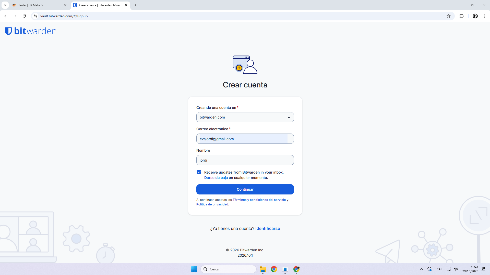

3. Verifica el correu electrònic amb l'enllaç que envia Bitwarden.
4. Crea la **contrasenya mestra**. Ha de ser llarga (es recomana una frase de diverses paraules) i no s'ha de fer servir enlloc més.

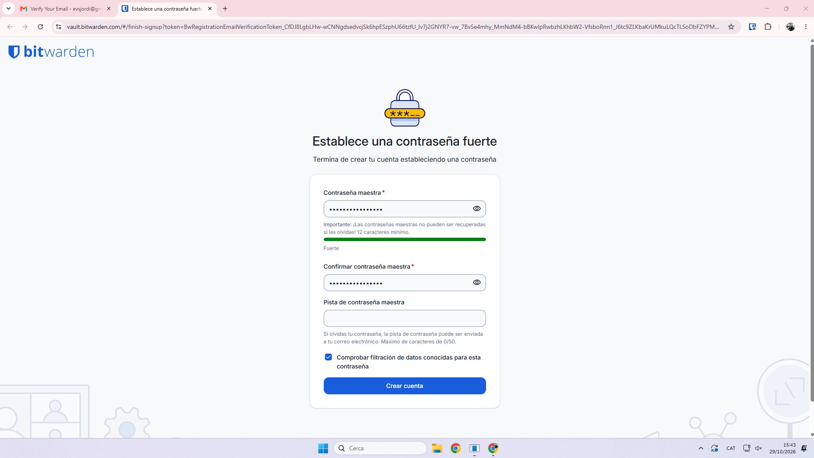

> ⚠️ **Important:** si s'oblida la contrasenya mestra, **no es pot recuperar** i es perden totes les dades. Bitwarden no la coneix.

5. Inicia sessió. Es mostra la caixa forta buida, a punt per desar credencials.

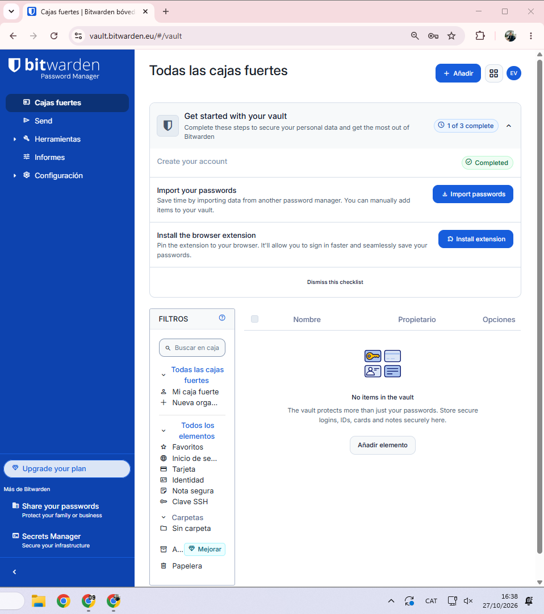

### 1.2 Instal·lar l'extensió del navegador

1. Des de la caixa forta, fes clic a **Install extension** o cerca "Bitwarden Password Manager" a la Chrome Web Store.
2. Fes clic a **Afegeix a Chrome**.

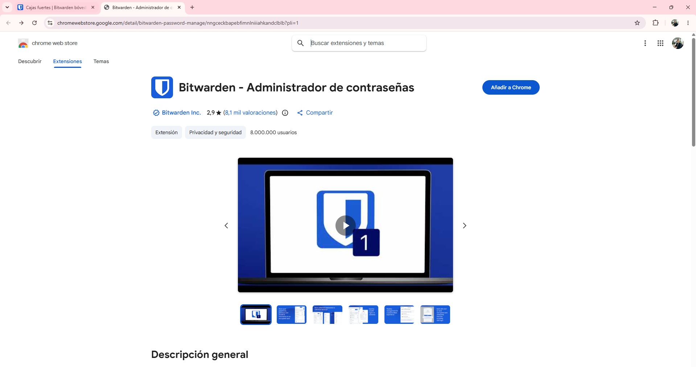

3. Fixa l'extensió a la barra amb la icona del trencaclosques i la xinxeta.
4. Obre l'extensió, selecciona el servidor **bitwarden.eu** i inicia sessió amb el mateix compte.

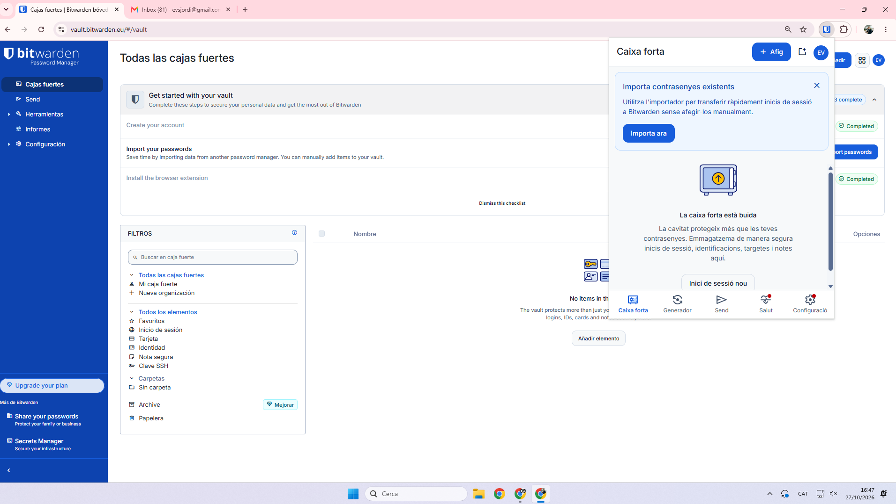

---

## 2. Generació de contrasenyes segures

El generador crea contrasenyes aleatòries. S'hi accedeix des de la pestanya **Generador** de l'extensió.

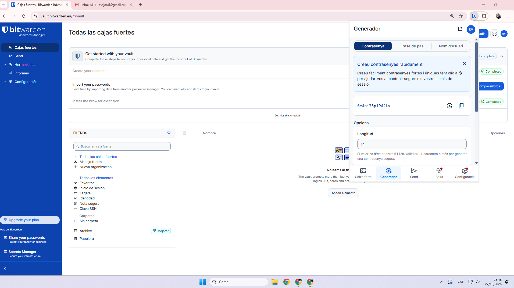

### 2.1 Paràmetres del generador

| Paràmetre | Què fa |
|---|---|
| **Longitud** | Nombre de caràcters de la contrasenya. Com més llarga, més segura. |
| **A-Z** | Inclou lletres majúscules. |
| **a-z** | Inclou lletres minúscules. |
| **0-9** | Inclou números. |
| **!@#$%^&\*** | Inclou caràcters especials. |
| **Mínim de números / especials** | Obliga que hi hagi una quantitat mínima de números o símbols. |
| **Evitar caràcters ambigus** | Treu caràcters que es confonen, com `0` i `O` o `l` i `1`. |

### 2.2 Exemples comparats

**Contrasenya feble:** 8 caràcters, només minúscules. Es pot trencar per força bruta en poc temps.

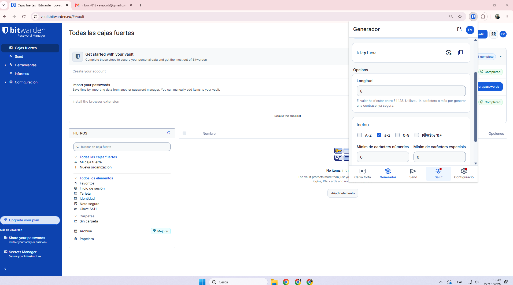

**Contrasenya bona:** 16 caràcters amb tots els tipus activats.

**Contrasenya molt bona (recomanada):** 24 caràcters amb tots els tipus activats.

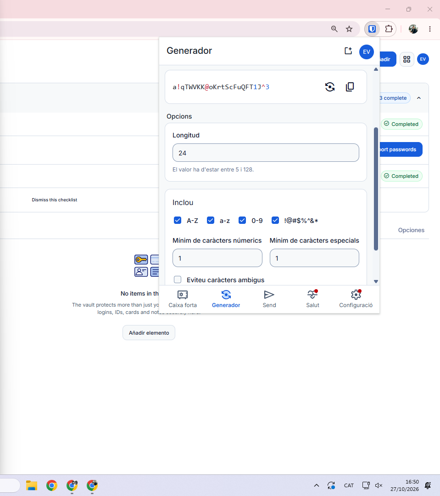

### 2.3 Frase de pas (passphrase)

L'opció **Frase de pas** genera diverses paraules aleatòries separades per guions. És molt segura i més fàcil d'escriure a mà. Permet escollir el nombre de paraules, el separador, si porta majúscules i si inclou un número.

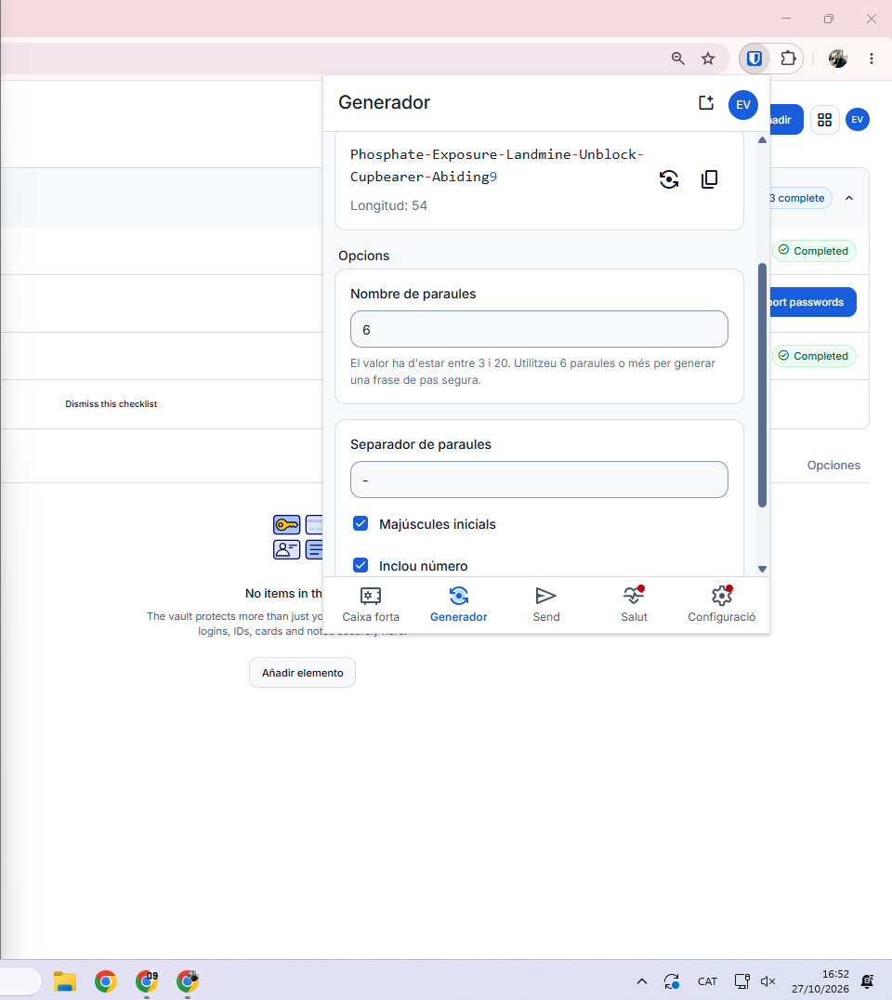

### 2.4 Política recomanada per a EverPia

| Tipus de compte | Configuració mínima |
|---|---|
| Serveis i comptes tècnics | 20 caràcters o més, tots els tipus activats |
| Contrasenyes que s'escriuen a mà | Frase de pas de 5 paraules o més, amb número |
| Contrasenya mestra | Frase de pas llarga + verificació en dos passos (2FA) |

---

## 3. Exemples d'ús i emplenament automàtic

### 3.1 Desar la credencial d'un compte de correu

1. A l'extensió, ves a **Caixa forta** → **+ Afig** → **Inici de sessió**.
2. Omple els camps:
   - **Nom de l'element:** Correu corporatiu EverPia
   - **Nom d'usuari:** tecnic@everpia.com
   - **Contrasenya:** prem la icona de generar perquè en creï una de segura
   - **Lloc web (URI):** https://mail.google.com
3. Fes clic a **Guarda**.

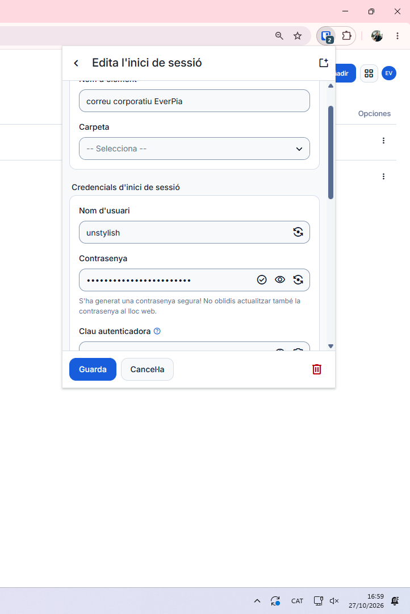

### 3.2 Desar la credencial d'una aplicació web

Es fa el mateix procés amb un servei web, en aquest cas **GitHub** (URI: https://github.com).

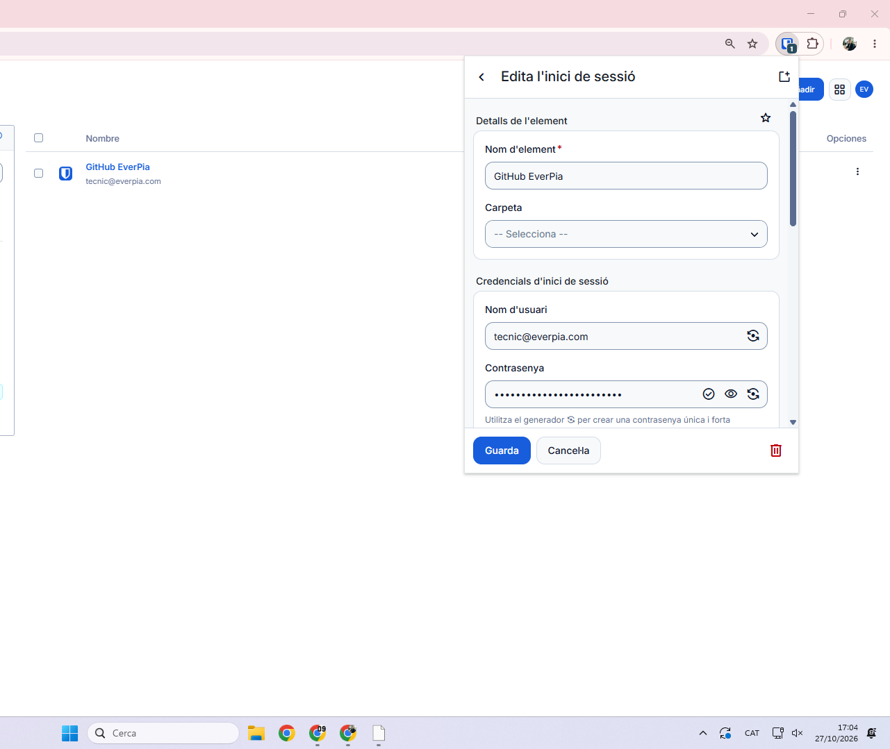

Les dues credencials queden desades a la caixa forta:

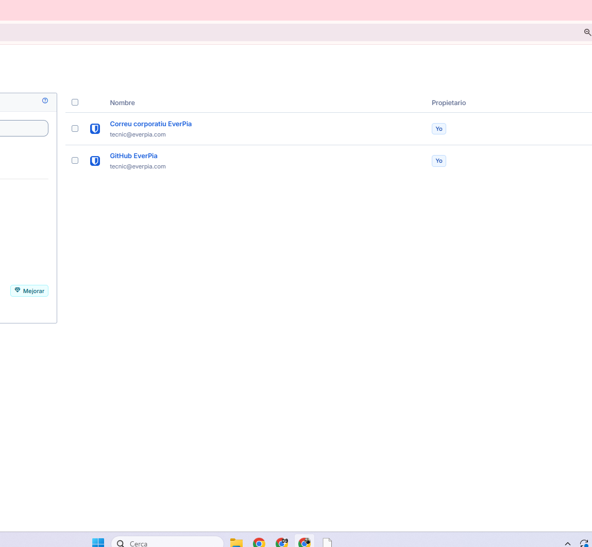

> 💡 La **URI** és molt important: Bitwarden només emplena les dades a la web correcta. Si l'usuari entra en una web falsa (*phishing*), Bitwarden no suggerirà la credencial.

### 3.3 Emplenament automàtic amb l'extensió

1. Obre la pàgina d'inici de sessió del servei (per exemple, github.com/login).
2. Fes clic al camp de l'usuari. Apareix un menú de Bitwarden amb la credencial desada.

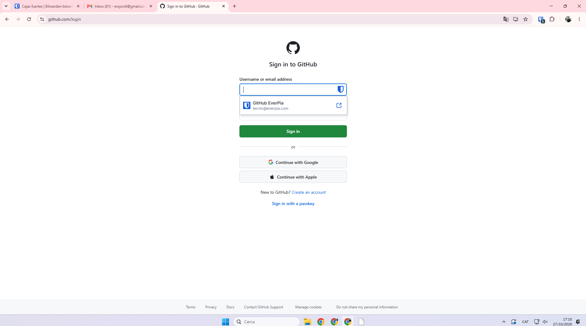

3. Fes clic a la credencial i l'usuari i la contrasenya s'emplenen sols.

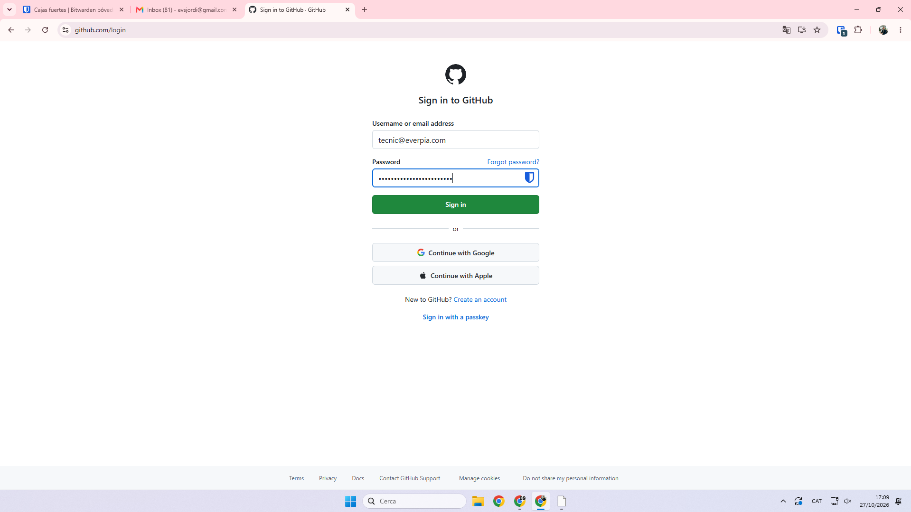

També es pot emplenar de dues maneres més:
- Fent clic a la **icona de Bitwarden** de la barra i prement **Emplena**.
- Amb la drecera de teclat **Ctrl + Shift + L**.

---

## 4. Gestió de còpies de seguretat (backup)

### 4.1 Fer la còpia de seguretat

1. A la caixa forta web, ves a **Herramientas** → **Export**.
2. A **Format de l'arxiu**, tria **.json (Encrypted)**.
3. A **Tipus d'exportació**, tria **Protegida amb contrasenya**.
4. Escriu una **contrasenya per a l'arxiu**, diferent de la mestra, i confirma-la.
5. Fes clic a **Export** i introdueix la **contrasenya mestra** per confirmar.

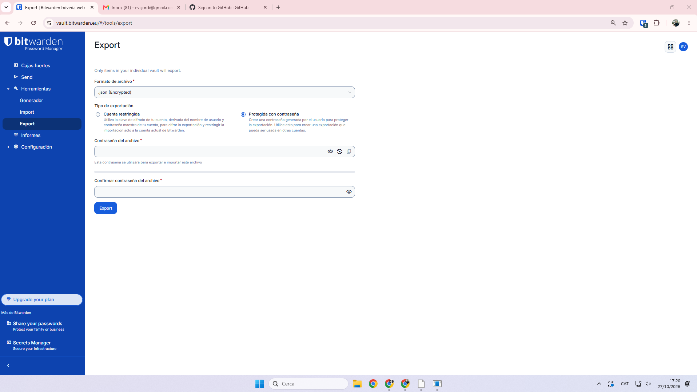

6. Es descarrega l'arxiu `bitwarden_encrypted_export_....json`.

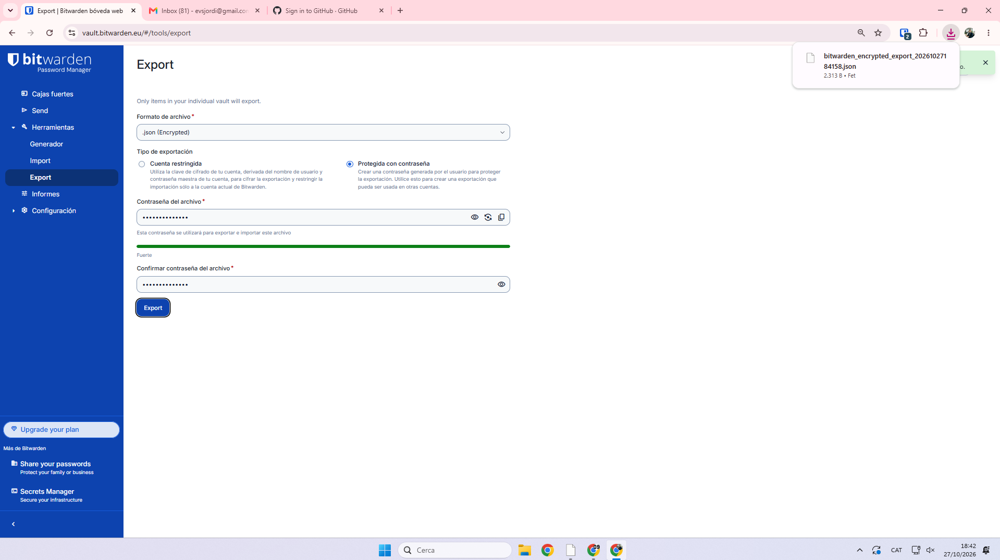

### 4.2 Comprovació del xifratge

En obrir l'arxiu amb el Bloc de notes es comprova que les dades estan **xifrades**:
- `"encrypted": true` indica que l'arxiu està xifrat.
- `"passwordProtected": true` indica que està protegit amb contrasenya.
- `"kdfIterations": 600000` indica que la clau es deriva amb 600.000 iteracions, cosa que dificulta molt els atacs de força bruta.
- `"data"` conté les credencials, però no es poden llegir sense la contrasenya de l'arxiu.

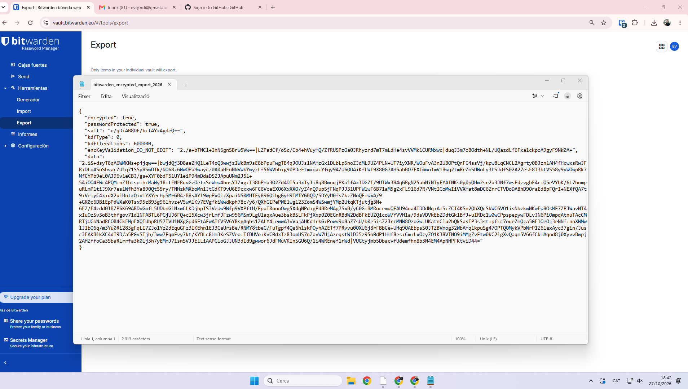

### 4.3 Formats d'exportació

| Format | Seguretat | Ús recomanat |
|---|---|---|
| `.json` | ❌ Text pla, tothom el pot llegir | No s'ha de fer servir per a còpies |
| `.csv` | ❌ Text pla | Només per migrar a una altra eina |
| `.json (Encrypted)` – Compte restringit | ✅ Xifrat amb la clau del compte | Només es pot importar al mateix compte |
| `.json (Encrypted)` – Protegit amb contrasenya | ✅ Xifrat amb contrasenya pròpia | **Opció recomanada per a backups** |

### 4.4 On guardar la còpia de seguretat

- **USB xifrat:** guardar l'arxiu en un USB xifrat amb **BitLocker To Go** (clic dret a l'USB → *Activar BitLocker*) o en un contenidor **VeraCrypt**.
- **Núvol xifrat:** com a alternativa, en un emmagatzematge al núvol amb xifratge.
- Fer una **còpia cada mes** i guardar l'USB en un **lloc físic diferent** de l'ordinador.
- **Esborrar l'arxiu de la carpeta Descàrregues** després de moure'l al lloc segur.

### 4.5 Restaurar la còpia

Si cal recuperar les dades, ves a **Herramientas** → **Import**, selecciona el format **Bitwarden (json)**, carrega l'arxiu i introdueix la contrasenya de l'arxiu.
